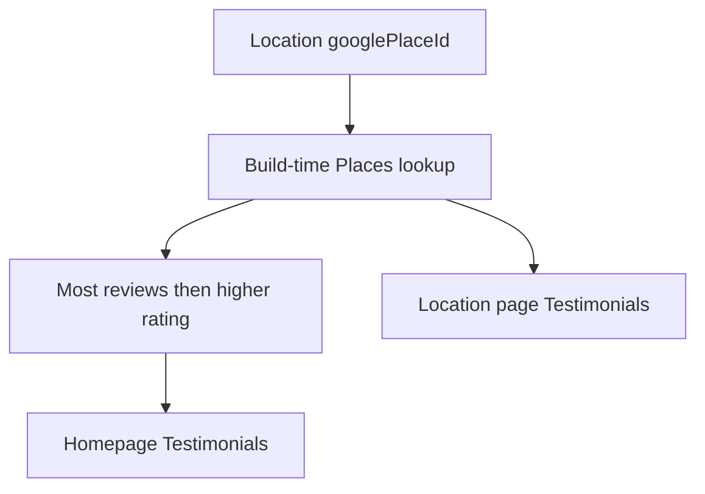

# Google reviews from each location

Use the **Places API (New)**. It is the supported way to show Google reviews on a public site: one server-side API key, up to five reviews per place, and the rating plus review count needed to pick a homepage profile. The key never reaches the browser. The Business Profile API is unnecessary for this.

Reviews are fetched during `astro build` and written into the existing [`Testimonials`](src/components/blocks/Testimonials.astro) block. There is no client request and no new runtime service. The current homepage quotes in [`src/pages/index.astro`](src/pages/index.astro) (Sarah M., James T., Maria L., and the fixed `4.9 / 5.0`) are replaced. Dental Pain Eraser quotes stay as written copy; they are not Google reviews.

## Place IDs on each office

Add an optional `googlePlaceId` string to the locations schema in [`src/content.config.ts`](src/content.config.ts), and set it on all 14 files in [`src/content/locations/`](src/content/locations/).

A one-time script, `scripts/resolve-place-ids.mjs`, calls Places Text Search with each office’s name and address and prints the candidate Place ID, display name, and address. Confirmed IDs are pasted into frontmatter by hand so a wrong business is not committed automatically. Draft offices may omit the field.

## Fetch and homepage ranking

New module [`src/lib/google-reviews.ts`](src/lib/google-reviews.ts):

- Reads `GOOGLE_PLACES_API_KEY` from the build environment (not a `PUBLIC_` variable).
- Requests `https://places.googleapis.com/v1/places/{id}` with field mask `rating,userRatingCount,googleMapsUri,reviews`.
- Keeps an in-process cache so the homepage and location pages share one lookup per place during a build.
- Maps each review to the testimonial shape: quote, author name, star rating, profile link, photo URL, and relative time. Review text is shown as Google returned it.
- `strongest()` picks the published location with the highest `userRatingCount`. A tie goes to the higher `rating`, then office name.

Homepage score becomes that place’s live rating (for example `4.8 / 5.0`) and a source line that names the office and count (for example `312 Google reviews · Raleigh`), plus a link to that listing.

[`src/pages/locations/[slug].astro`](src/pages/locations/[slug].astro) gets the same block after the doctors section, using only that office’s reviews, rating, count, and Maps link. An office with a Place ID but zero reviews omits the block.

## Attribution in the testimonial block

Extend [`Testimonials.astro`](src/components/blocks/Testimonials.astro) only as far as Google’s display rules require:

- Author name links to their Google profile when a URI is present.
- Profile photo when Google provides one.
- A “Google” attribution line and a “Read more reviews” link to `googleMapsUri`.
- Drop treatment tags for these reviews; Google does not supply them.

The grid already supports three columns, so up to five cards wrap onto a second row.

## When the key or an ID is missing

- Local `astro dev` / `astro build` without the key: skip both review blocks and print a warning. The rest of the site still builds. Do not keep the placeholder quotes, because they are labeled as Google reviews.
- Key present, and a published location has no `googlePlaceId` or Places returns an error: fail the build. A deploy must not ship a location page that silently lost its reviews.

## Secrets and freshness

Google allows this content to be stored for performance for up to 30 days, and it must not be checked in. Review JSON stays out of git.

- Add `GOOGLE_PLACES_API_KEY` as a secret on the `staging` and `production` GitHub Environments, and pass it into the build step in [`.github/workflows/deploy.yml`](.github/workflows/deploy.yml).
- Restrict the key in Google Cloud to the Places API (New) only. GitHub-hosted runners do not have stable IPs, so an IP restriction is not workable. Set a quota alert.
- Document the secret and the Place ID field in [`docs/HOSTING.md`](docs/HOSTING.md).
- Add a weekly schedule on the existing deploy workflow for **staging only**, so staging reviews refresh without a code change. Production still updates on the manual promote, which already rebuilds. Production has required reviewers, so a cron cannot publish there unattended. Running that same workflow by hand is the refresh path for the live site.

## Verify

Build once with a key and confirmed Place IDs. Check the homepage uses the office with the largest review count, and open two location pages to confirm each shows its own reviews, author links, and Maps link. Build again with the key unset and confirm the pages render without the review blocks and without the old placeholder quotes.